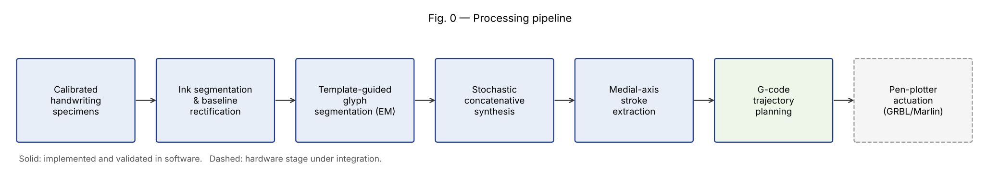
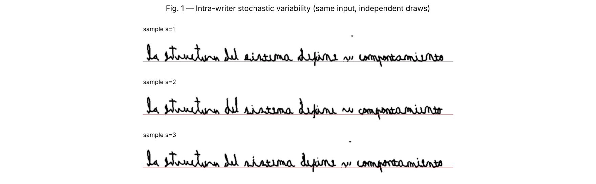
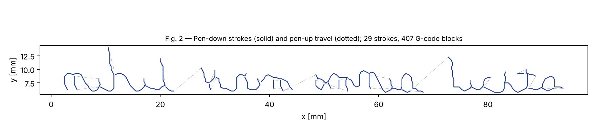

# Manualis

**Writer-specific concatenative synthesis of cursive handwriting, with stroke-level trajectory planning for planar pen actuation.**

Manualis is a research codebase that studies how far a *non-parametric*, sample-based approach can go in reproducing an individual's cursive handwriting, without training a generative neural model and without per-use inference cost. The system learns from a small calibrated set of handwriting specimens, synthesizes arbitrary Spanish text (including diacritics and the letter *ñ*), and converts the synthesized ink into ordered pen trajectories suitable for a Cartesian pen-plotter.

## Motivation

Modern handwriting generators (diffusion- and transformer-based few-shot models) produce convincing word images, but they are typically trained on English corpora, require GPU inference for every request, and output raster images rather than physically executable strokes. Manualis explores the opposite corner of the design space:

| Property | Neural few-shot generators | Manualis |
|---|---|---|
| Writer fidelity | Learned approximation | Real specimen ink, recombined |
| Spanish diacritics (á é í ó ú ü ñ ¿ ¡) | Limited | Native |
| Compute per generation | GPU inference | CPU only, offline |
| Output | Raster image | Raster page **and** ordered pen strokes (G-code) |

The working hypothesis is that, for a single writer, a well-curated specimen bank plus deterministic geometric composition is competitive in legibility and superior in cost and reproducibility.

## Method (summary)

1. **Specimen acquisition.** A calibration form with fiducial markers collects four realizations of each character, plus continuous cursive sentences.
2. **Ink segmentation and rectification.** Ink is separated from ruled paper by morphological black-top-hat filtering and chromatic gating. Ruling curves are fitted per line, and each line is resampled onto a rectified baseline frame.
3. **Template-guided glyph segmentation.** Cursive words are cut into glyphs by a dynamic-programming alignment against per-class templates. The templates are refined iteratively with an EM-style loop, and each glyph keeps entry and exit anchors.
4. **Stochastic concatenative synthesis.** Whole-word specimens are used when available. Otherwise glyphs are concatenated and joined by Bézier connectors between exit and entry anchors, with controlled jitter in scale, baseline, slant and pressure.
5. **Medial-axis stroke extraction.** Synthesized ink is skeletonized and traced into ordered polylines.
6. **Trajectory planning.** Polylines are emitted as G-code with explicit pen-up and pen-down states.

Details: [`docs/METHOD.md`](docs/METHOD.md).

## Results

*Fig. 1 — The same input rendered with three independent random draws. No two realizations are identical, matching natural intra-writer variability.*

*Fig. 2 — Ordered pen trajectories derived from synthesized ink (simulation). The corresponding program is in [`examples/sample_toolpath.gcode`](examples/sample_toolpath.gcode).*

**Legibility evaluation.** Legibility is measured with a word-spotting protocol: each synthesized word is retrieved against the writer's real word specimens using HOG descriptors, and the self-retrieval rate of real specimens is reported as the ceiling. Successive versions improved top-1 retrieval from 0.275 to 0.425 against a ceiling of 0.533. Ablations covered segmentation strategy, template count and connector policy. Each change was accepted only if the metric did not regress.

## Status

| Component | Status |
|---|---|
| Specimen processing, glyph bank, synthesis, page layout | Implemented |
| Stroke extraction and G-code generation | Implemented, **validated in simulation** |
| Physical actuation on a modified FDM gantry (GRBL/Marlin) | **Integration in progress** |

## Scope and responsible use

Manualis is intended for research on handwriting modelling, for accessibility (for example, writing support for people with motor impairments), and for robotic pen-plotting of a consenting writer's own hand. Every specimen bank represents one consenting writer. The repository contains no specimen data.

## License

MIT. See `LICENSE`.
